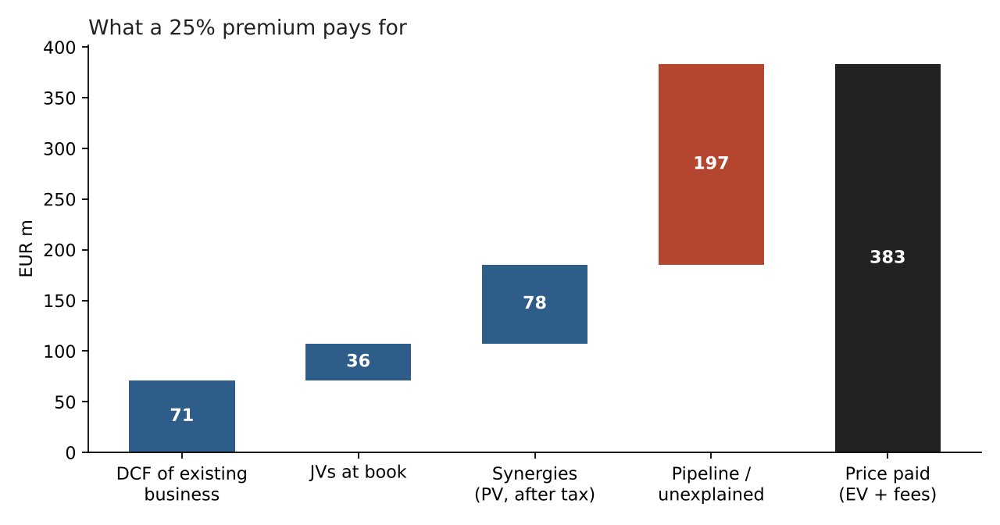
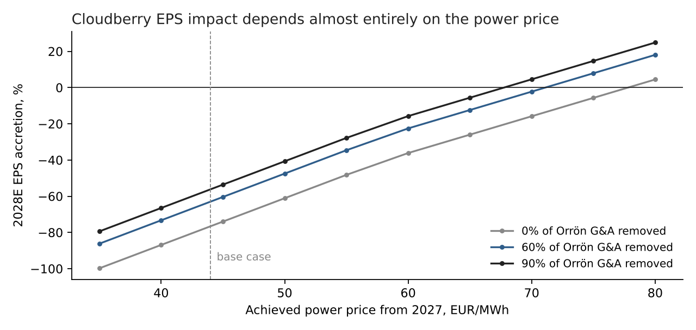

# Cloudberry / Orrön Energy – a merger case study

A hypothetical deal: Cloudberry Clean Energy (Oslo) buys Orrön Energy (Stockholm) in an
all-share offer at a 25% premium. I built it to answer one question: would this be a good
deal for Cloudberry shareholders at today's prices?

**Short answer: no, not at a premium.** Orrön's existing wind fleet does not earn enough at
current Nordic power prices to support what the offer pays. The deal cuts Cloudberry's
earnings per share by more than half in every forecast year, and only breaks even on EPS if
achieved power prices reach about **EUR 71/MWh** (Orrön got EUR 36 in 2025).

This is not investment advice and nothing here is based on non-public information.

## The numbers

| | |
|---|---|
| Offer price | SEK 11.00 per Orrön share (SEK 8.80 + 25%) |
| Equity value / transaction EV | EUR 286m / EUR 379m |
| EV / EBITDA 2028E | 42x |
| Price / book | 0.88x |
| Orrön holders' stake in the combined company | 46% |
| EPS impact for Cloudberry, 2027E / 2028E / 2029E | -89% / -63% / -59% |
| Net debt / EBITDA after closing, 2027E | 6.5x (Cloudberry alone: about 5.3x) |



The bridge splits the price into what I can value and what I can't. A DCF of the existing
business gives EUR 71m, the JV stakes are carried at book (EUR 36m), and the synergies are
worth about EUR 78m after tax. The remaining EUR 197m would have to come from Orrön's
development pipeline, which the model does not value. So the deal is really a bet on that
pipeline and on power prices, not on the operating assets.



Synergies help, but the power price matters far more. Cloudberry's own earnings are held
at my estimates in this chart, so it only shows the Orrön side.

## What is in the model

`Cloudberry_Orron_MA_Model.xlsx` – every calculated cell is a live formula linked to the
Inputs sheet, so you can change an assumption in Excel and see it flow through.

| Sheet | Contents |
|---|---|
| Summary | Offer, value bridge, EPS and leverage |
| Inputs | Market data, deal terms, FY2025 reported figures, forecast drivers (blue) |
| Orron | Standalone income statement, cash flow and balance sheet, 2025A–2030E. RCF draws to keep minimum cash; balance check every year |
| DCF | Unlevered DCF of the existing business at 7.5% WACC, 2% terminal growth |
| Deal | Offer, consideration, exchange ratio, ownership, purchase price allocation |
| Pro forma | Synergy schedule, accretion/dilution 2027E–2029E, leverage |
| PF balance sheet | Both balance sheets at 31 Dec 2025 combined, with deal adjustments |
| Sensitivities | Premium × stock share, power price × synergies, WACC × growth, price × opex |

Two accounting points that come out of the numbers:

- The offer (EUR 286m) is below Orrön's book equity (EUR 324m), so there is no goodwill.
  I write PP&E down by the difference instead, which lowers D&A by about EUR 2m a year.
- Orrön has made losses for two years, so I do not carry tax losses forward. That is
  slightly conservative.

## Where the inputs come from

Reported (FY2025, consolidated):
- Orrön: [year-end report 2025](https://www.orron.com/year-end-report-2025/) for revenue,
  EBITDA, EBIT, net result, capex, debt and cash; balance sheet lines from
  [stockanalysis.com](https://stockanalysis.com/quote/sto/ORRON/financials/balance-sheet/).
- Cloudberry: [annual report 2025](https://www.cloudberry.no/assets/Cloudberry-Clean-Energy-2025-Annual-report.pdf)
  for debt, cash, assets and equity.
- Share prices and share counts: stockanalysis.com (Orrön 4 Nov 2026, Cloudberry 29 Sep 2026).

My own assumptions (all on the Inputs sheet, change them freely):
- Orrön generation 760 GWh in 2026, then 800 GWh. The company guides 800–950 GWh on a
  proportionate basis; consolidated volumes run about 13% lower.
- Achieved price EUR 38/MWh in 2026, rising to EUR 46 by 2030.
- Operating cost EUR 21–22/MWh, G&A about EUR 9m, Sudan legal costs ending in 2026.
- Cloudberry net income NOK 165m in 2026 rising to NOK 225m. Its forward P/E points to
  roughly NOK 165m for the next twelve months; the later years are my guess.
- Synergies: 60% of Orrön's G&A plus EUR 1/MWh on O&M, half in 2027 and fully from 2028.
- EUR/SEK 11.0 and EUR/NOK 11.7.

What the model leaves out: Orrön's development pipeline, any change in Cloudberry's own
forecasts after the deal, hedging, and working capital movements.

## Running it

```bash
pip install -r requirements.txt
python model.py          # prints the main outputs
python build_model.py    # writes the Excel file
python make_charts.py    # writes the two charts
pytest                   # checks
```

`model.py` holds the logic in plain Python. `build_model.py` writes the same logic into Excel
as formulas, and stores the Python results as the cached values. The tests check that the
balance sheets balance, that cash ties to the cash flow, a few results by hand, and then
open the workbook in LibreOffice, recalculate every formula and compare it with Python
(skipped if LibreOffice isn't installed).

Other files: `Investment_Memo.md` / `.pdf` (one page) and `Pitch_Deck.md` (five slides).

## Changes from the first version

The first version (August 2026) used made-up figures for Orrön: a 35% EBITDA margin, positive
net income and no debt. It showed the deal as EPS-accretive, but the workbook did not
actually produce the numbers in the README, and there was no balance sheet. I rebuilt it on
reported FY2025 figures, which changed the conclusion.
